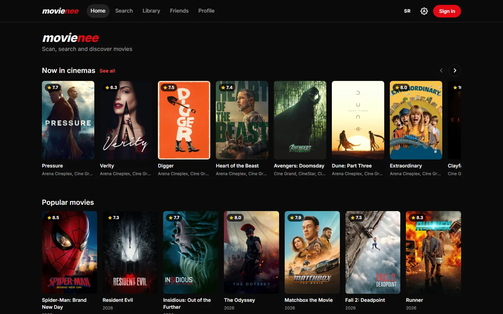
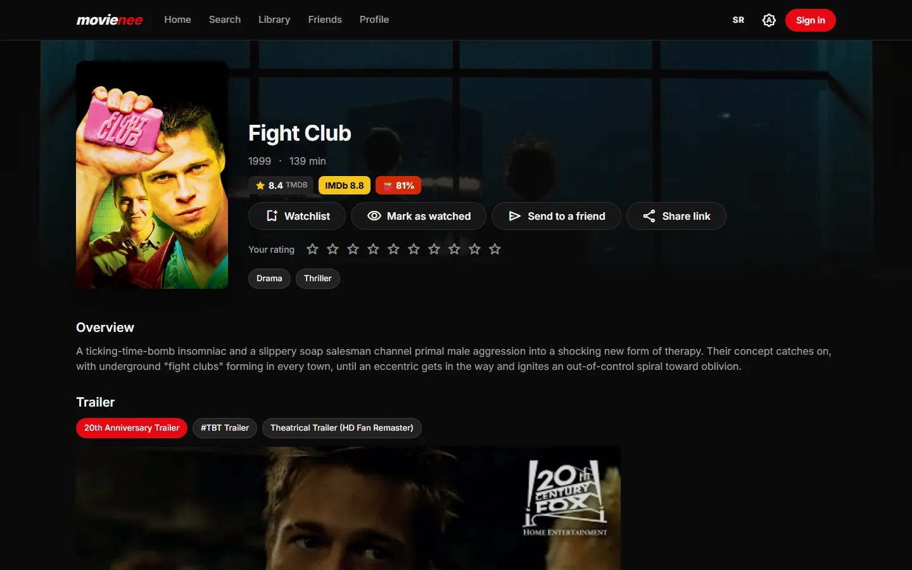
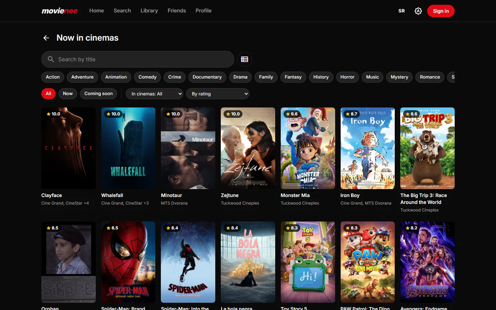
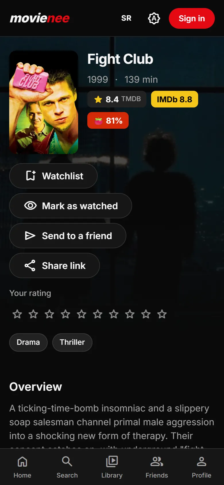
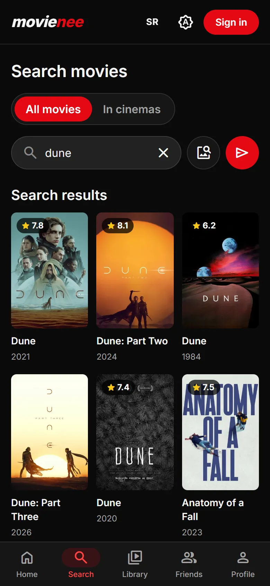

# Movienee Web

**Live: https://movienee.web.app**

The web version of Movienee: discover movies, see which cinemas in Serbia are showing them, keep a
watchlist and ratings, recognize a movie from a photo, and plan a movie night with friends. It is a
separate Angular app written from scratch, talking to the same Ktor backend as the Android app, so
an account, its library and its friends are shared between the two.



| Movie | Now in cinemas |
|---|---|
|  |  |

| Phone: movie | Phone: search |
|---|---|
|  |  |

## Features

- **Discover** - trending and personalized suggestions, what is playing in cinemas now (filters by
  genre, chain, status), movie and person pages with trailers, stills, cast and ratings from TMDB,
  IMDb and Rotten Tomatoes.
- **Search** - as you type over the whole catalog; in the cinema mode a local title filter plus an
  AI search by description or mood; **image search**: a photo of a poster or film still is shrunk in
  the browser and recognized by the backend (Gemini vision).
- **Cinemas** - where a movie is playing, sorted by distance (browser geolocation, on request).
- **Account** (Google sign-in) - watchlist, watched list with 1-10 ratings, comments with likes,
  profile with avatar, name and taste profile.
- **Friends** - requests, user search, a friend's profile (limited preview until accepted), taste
  match, **Movie Night** suggestions for two, sending a movie to a friend, "friends who watched
  this", notifications with unread badges.
- **Everywhere** - Serbian and English, dark / light / system theme, works from 375 px phones to
  desktop, shareable links (`/m/{id}` previews in messengers and opens the Android app if installed).
- **Installable (PWA)** - add it to the home screen or desktop; it opens in its own window, starts
  instantly from the cache, shows the app (not a browser error) without a connection, and offers a
  reload when a new version is deployed.

## Stack

Angular 22 (standalone components, signals, zoneless) · TypeScript (strict) · SCSS · Angular CDK ·
Transloco (Serbian / English) · Firebase Authentication (Google) · Firebase Hosting · Vitest ·
ESLint · Prettier · GitHub Actions

## Engineering notes

- **Session security** - the backend JWT is kept in memory only, never in `localStorage`; after a
  reload it is renewed from the Firebase session before the first backend request (one shared
  renewal for parallel requests). A 401 renews once and retries; only a session that really ended
  signs the user out, a network error or a sleeping backend does not.
- **Strict hosting headers** - Content Security Policy without inline scripts, `frame-ancestors
  'none'`, `nosniff`, a narrow Permissions-Policy (`firebase.json`).
- **Optimistic UI without races** - watchlist, ratings and likes update instantly; requests per
  movie run in order and a failure rolls back only that movie. Friendship actions on one user never
  overlap, so the client and the server cannot drift apart.
- **Performance** - lazy-loaded screens, responsive TMDB images (`srcset`), priority loading for the
  first posters, and an icon font cut down to the 54 icons the app uses (1.4 MB -> 22 kB;
  `tools/check-icons.mjs` fails the lint when an icon is missing from the list).
- **Service worker** - caches only the app itself (code, translations, icons, fonts), never the
  backend's data; content-hashed files are cached forever, the worker files never
  (`ngsw-config.json`, `firebase.json`).
- **Accessibility** - Lighthouse accessibility 100: keyboard navigation, visible focus, WCAG AA
  contrast in both themes, labelled controls, rating stars as a slider.
- **One source of texts** - translations are generated from the Android app's `strings.xml`, so
  both apps say the same thing.

## Getting started

Requirements: Node 24 LTS (or 22.22.3+).

```bash
npm install
npm start            # http://localhost:4200, uses the hosted backend
npm run lint         # ESLint + icon check
npm run test:ci
npm run build        # dist/movienee-web/browser
```

## Project structure

```
src/app/
  core/       api/ (one service per backend area), auth/, http/ (interceptors, friendly errors),
              models/ (TypeScript types = the backend JSON contract), prefs/ (language, theme),
              state/ (library and social stores), util/
  shared/     layout/ (app shell with top and bottom navigation), ui/ (reusable components)
  features/   one folder per screen, lazy-loaded
public/i18n/  sr.json, en.json - generated from the Android app's strings
i18n-web/     web-only translations, merged into public/i18n by the sync script
tools/        string conversion and icon check scripts
```

Rules: features never call `HttpClient` directly, only services in `core/api`; components in
`shared/ui` are presentational (inputs/outputs only).

## Translations

```bash
npm run i18n:sync    # ../MovieLens/app/src/main/res -> public/i18n/{sr,en}.json
```

Android placeholders (`%1$s`) become Transloco parameters (`{{p1}}`). Web-only texts go to
`i18n-web/{sr,en}.json`.

## Configuration

`src/environments/environment.base.ts` holds the backend URL and the Firebase web config (not
secret - it is part of every web app's public bundle). The backend must allow this app's origin in
its `ALLOWED_ORIGINS` environment variable, and the domain must be listed in Firebase
Authentication -> Settings -> Authorized domains for Google sign-in to work.

## Deployment

Pushes to `main` are linted, tested, built and deployed to Firebase Hosting
(`.github/workflows/ci.yml`, site `movienee` -> https://movienee.web.app).
